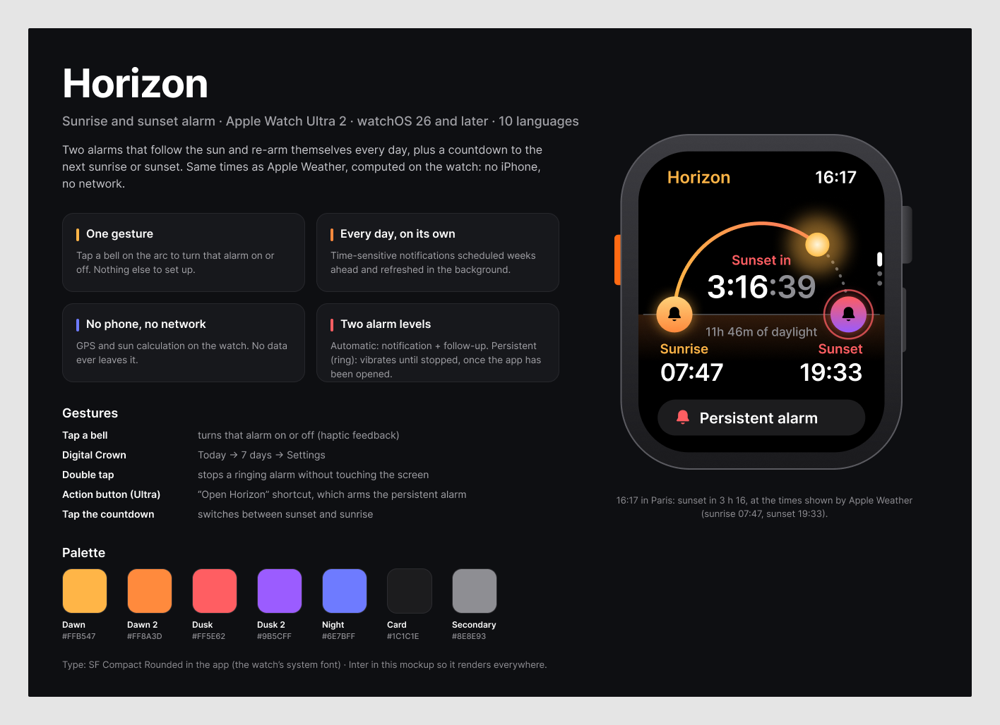
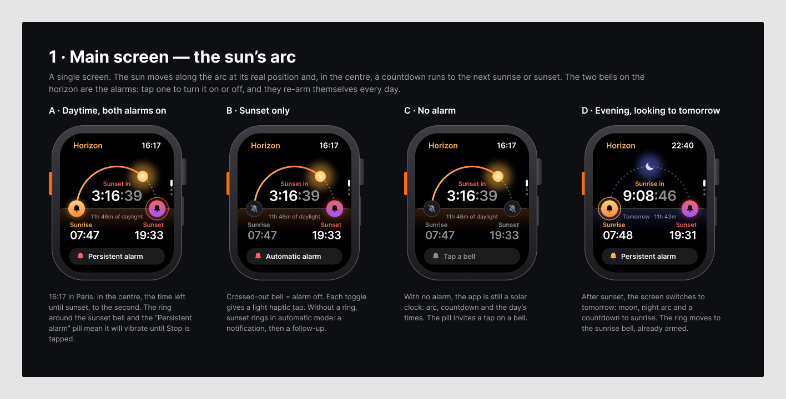
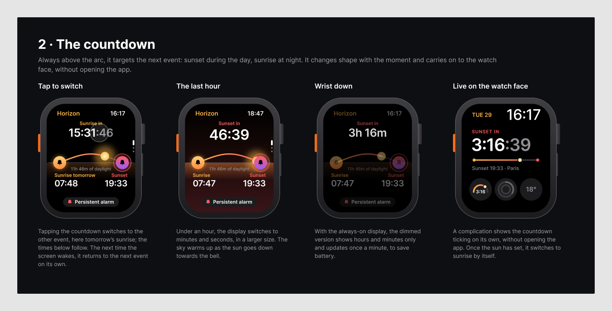
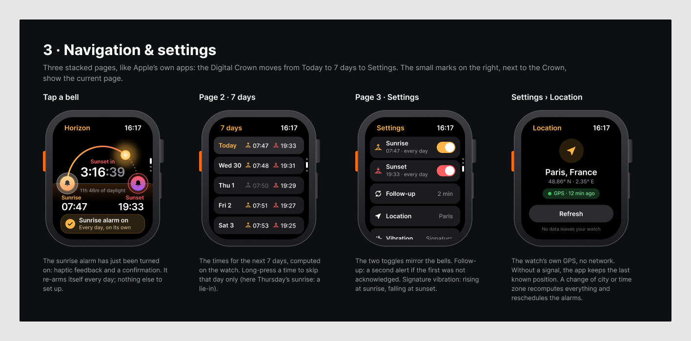
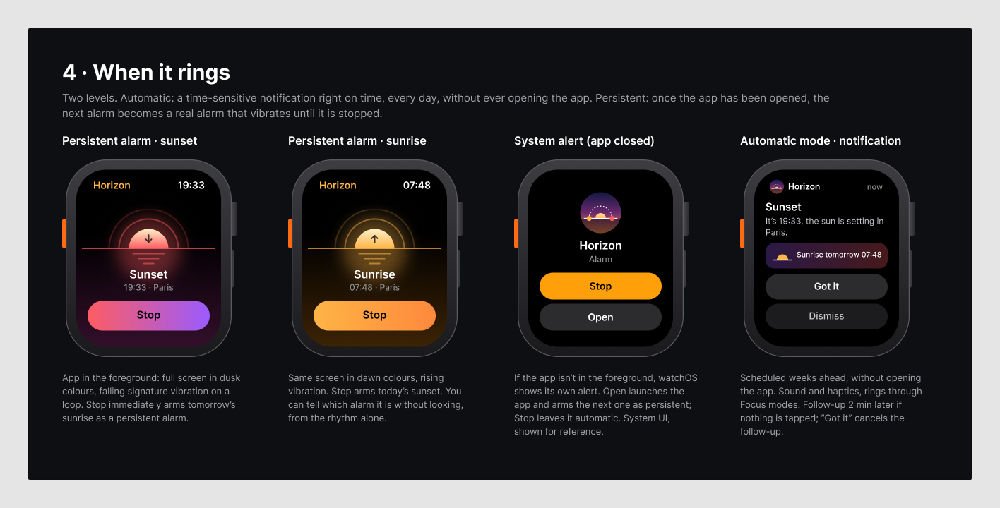
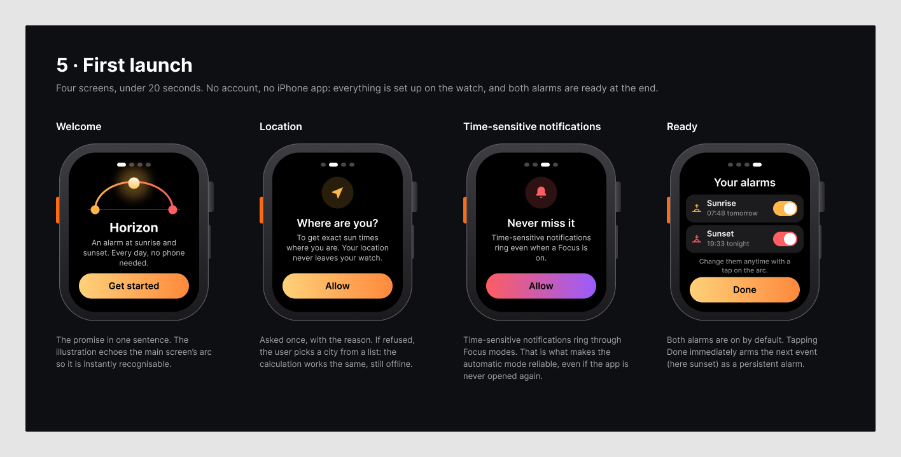
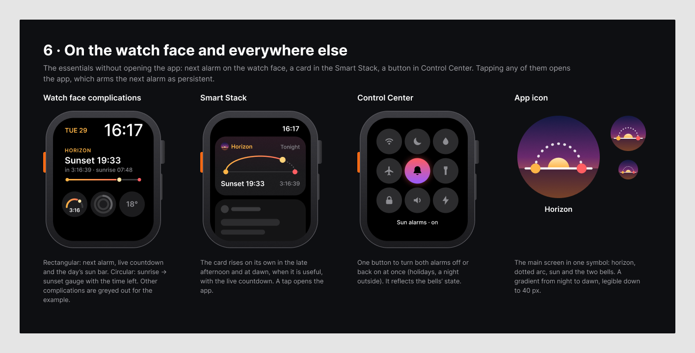
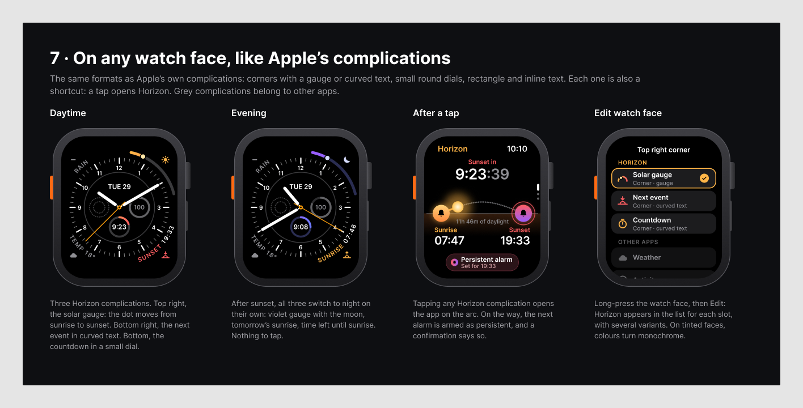
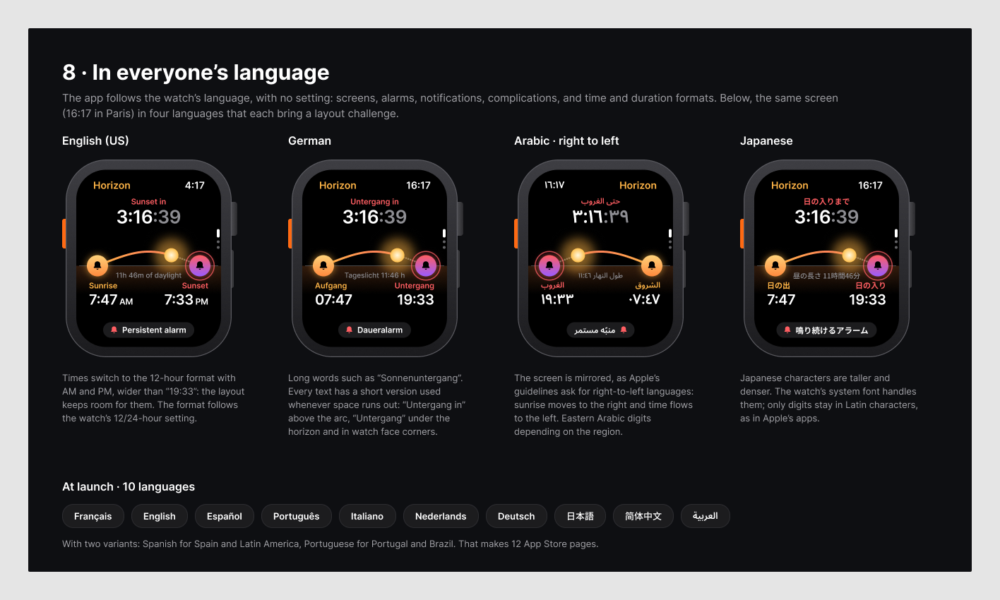

# Horizon — Product and technical specification

| | |
|---|---|
| Version | 0.1 (draft) |
| Date | 2026-10-04 |
| Platform | Apple Watch, watchOS 26 and later, no iPhone app |
| Mockup | [`mockup/`](mockup/) — one image per design section, 0 to 8 |
| UI strings | [`strings.csv`](strings.csv) — every string in 12 locales |
| Test data | [`fixtures/sun-times.csv`](fixtures/sun-times.csv) |

---

## 1. What Horizon is

Horizon is an Apple Watch app that rings at **sunrise** and at **sunset**, every day, at the exact times shown by Apple's Weather app. It works with no iPhone nearby and no network.

### Product principles

1. **One gesture.** Tapping a bell on the sun's arc turns that alarm on or off. Nothing else needs setting up.
2. **Every day, on its own.** Alarms re-arm themselves daily. The user never has to "set" tomorrow's alarm.
3. **No phone, no network, no account.** Everything is computed on the watch. No data ever leaves it.
4. **Same times as Weather.** Official sunrise and sunset, computed for the watch's own position.
5. **Glanceable.** A live countdown to the next event, in the app and on the watch face.
6. **Everyone's language.** Ten languages at launch, right-to-left included.

### Who it's for

People who live by daylight: hikers, sailors, photographers, runners, people who fast or pray at sunrise and sunset, or anyone who wants a nudge to go outside before dark.



---

## 2. Platform and constraints

| Topic | Decision |
|---|---|
| App type | watchOS-only app (Xcode template "Watch App", no iOS companion) |
| Language and UI | Swift, SwiftUI |
| Deployment target | **watchOS 26.0**. Every API used exists in watchOS 26. The app runs on watchOS 27 too. |
| Build toolchain | **Xcode 26** (works on Intel Macs). From **April 2027** App Store uploads require the watchOS 27 SDK, so Xcode 27 (Apple silicon only); builds then go through **Xcode Cloud** (25 compute hours a month included with the developer program). |
| Network | None. No network entitlement, no third-party SDK, no analytics. |
| Data | Stored on the watch only (App Group `UserDefaults` shared with the widget extension). |

### Hard limits imposed by watchOS (these shape the design)

| Limit | Consequence |
|---|---|
| A real alarm (a `WKExtendedRuntimeSession` of type *smart alarm*) can only be **scheduled while the app is in the foreground**, **one at a time**, **up to 36 hours ahead**. | Two alarm levels (section 4): automatic notifications every day, upgraded to a persistent alarm whenever the app has been opened. |
| An app can keep **64 pending local notifications** at most. | The automatic level schedules about 15 days ahead and refills itself (section 4.2). |
| AlarmKit (system alarms) exists on iOS/iPadOS only, not watchOS. | Not used. |
| Apps cannot place complications on the user's watch face themselves. | The user adds them in "Edit watch face" (section 7). |

---

## 3. Sun calculation

### 3.1 Definition

- **Sunrise / sunset** = the moment the sun's upper edge touches the horizon, with standard atmospheric refraction: solar altitude **−0.833°** (zenith 90.833°). This is the convention used by Apple Weather, NOAA and most almanacs.
- Algorithm: **NOAA solar calculator equations** (based on Meeus, *Astronomical Algorithms*), implemented in Swift with no dependency (`SunCalculator`, about 150 lines).
- Inputs: latitude, longitude, date, time zone. Output: sunrise, sunset, solar noon, day length, or a polar flag.

### 3.2 Accuracy target

- Within **±60 seconds** of Apple Weather for the same coordinates.
- Moving 20 km east or west shifts the times by about 1 minute. Apple Weather computes for the city shown; Horizon computes for the watch's own GPS position. Small differences are expected and acceptable.
- Unit tests run against [`fixtures/sun-times.csv`](fixtures/sun-times.csv) (NOAA reference values, computed independently). Before release, a few rows are cross-checked by hand against Apple Weather.

### 3.3 Edge cases the calculator must handle

| Case | Example | Expected behaviour |
|---|---|---|
| Polar day | Tromsø, 21 June | No sunset. UI shows "The sun doesn't set today"; no alarms that day. |
| Polar night | Tromsø, 21 December | No sunrise. UI shows "The sun doesn't rise today"; no alarms that day. |
| Sunset after local midnight | Reykjavik, 21 June (sunset 22 June 00:02) | The event belongs to the evening of 21 June. Planning works on **events in absolute time**, not on calendar dates. |
| Daylight-saving change | Paris 29 March, New York 8 March | Times are computed in UTC, then shown in the current time zone. |
| Southern hemisphere | Sydney | No special case; the arc still runs from sunrise to sunset. |
| Equator | Quito | Nearly constant 12 h days; no special case. |
| Travel / time zone change | Paris → New York | Recompute and reschedule on time zone change and on a location change of more than 20 km. |

### 3.4 Location

- `CLLocationManager`, *when in use* authorization, accuracy about 1 km (reduced accuracy is enough).
- Refreshed when the app opens, from the Location screen, and during background refresh when allowed.
- The **last known position** is cached and used when no fix is available (indoors, airplane mode).
- **City name offline**: reverse geocoding needs the network, so the place name ("Paris, France") comes from a bundled city list (GeoNames *cities15000*, CC BY 4.0, attribution in the app's About section). The same list powers the manual "Choose a city" fallback when location is denied.

---

## 4. Alarms

### 4.1 Model

- Two independent toggles: **sunrise** and **sunset**. Both are on after onboarding.
- An enabled alarm fires **every day** at that day's event, with no further action.
- A single occurrence can be **skipped** from the 7-day page (long press) and restored.
- Persisted state: `sunriseEnabled`, `sunsetEnabled`, `skippedOccurrences` (event ids), `followUp` (off / 2 min / 5 min, default 2 min), `vibration` (signature / standard), `lastLocation`.

### 4.2 Level 1 — Automatic (notifications)

Works every day, even if the app is never opened again.

- `UNUserNotificationCenter` local notifications with `interruptionLevel = .timeSensitive` (capability **Time Sensitive Notifications**), sound `.default`.
- For each enabled occurrence: one **main** notification at the event time plus one **follow-up** N minutes later (if the follow-up setting is on).
- Budget: 64 pending requests, at most 4 per day (2 events × 2), so **15 days are scheduled ahead** (60 requests). The 61st request is a **refill reminder** at the end of the window: "Open Horizon to keep your alarms coming."
- **Refill**: the whole plan is recomputed and rescheduled
  - on every app launch and every return to the foreground,
  - in a daily background refresh (`.backgroundTask(.appRefresh)`),
  - after any settings change, location change of more than 20 km, or time zone change.
- Content (localized): title "Sunset", body "It's 19:33, the sun is setting in Paris.", a line with the next event ("Sunrise tomorrow 07:48"), actions **Got it** and the system Dismiss.
- **Got it** cancels that occurrence's follow-up. Opening the app also cancels pending follow-ups for past events.

### 4.3 Level 2 — Persistent alarm (smart alarm session)

A real alarm that keeps vibrating until stopped. Available for the **next** enabled occurrence once the app has been opened.

- `WKExtendedRuntimeSession` with background mode **Smart alarm** (`WKBackgroundModes = alarm`), scheduled with `start(at:)` at the event time.
- **Arming rule**: each time the app becomes active (launch, complication tap, notification tap, "Open" from an alarm, end of onboarding), arm a session for the next enabled, non-skipped occurrence within 36 hours. Only one can be armed.
- When armed, that occurrence's main notification is **moved 60 s later as a fallback**. It is cancelled as soon as the session starts (`extendedRuntimeSessionDidStart`). If the session fails, the fallback still rings.
- At start: call `notifyUser(hapticType:repeatHandler:)` immediately.
  - **Signature** vibration: `.directionUp` repeated for sunrise, `.directionDown` for sunset, so the user knows which one it is without looking.
  - **Standard**: `.notification`.
- If the app is not in the foreground, watchOS shows its own alarm alert with **Stop** and **Open**. Open launches the app, which arms the next occurrence. Stop leaves the next occurrence in automatic mode.
- If the app is in the foreground, it shows the full-screen alarm (section 5.4). Its **Stop** button invalidates the session and immediately arms the next occurrence.
- **Double tap** (thumb and index finger) triggers Stop (`.handGestureShortcut(.primaryAction)`).
- The **ring around a bell** on the main screen means "this occurrence is armed as a persistent alarm".

### 4.4 App Review note

Apple documents the smart alarm session for waking users. In the review notes, explain that Horizon is an alarm app whose alarms are tied to sunrise and sunset, that the session is only scheduled at those times, and that it is the only way for a watchOS app to ring until stopped.

---

## 5. Screens

Each part links to its image in [`mockup/`](mockup/). Times in examples are Paris, 29 September 2026: sunrise 07:47, sunset 19:33.

### 5.1 Main screen — the sun's arc



- **Title bar**: "Horizon" and the time.
- **Arc**: a half-ellipse above a horizon line. The left end is sunrise, the right end sunset (mirrored in right-to-left languages, see section 8). The part already travelled is drawn as a gradient (dawn orange to dusk pink), the rest dotted.
- **Sun**: placed on the arc at the fraction of daylight already elapsed, `(now − sunrise) / (sunset − sunrise)`, with a soft glow.
- **Two bells (nodes)** on the horizon, at the arc ends:
  - on: filled gradient bell, glow;
  - off: dark circle, crossed-out bell;
  - ring around it: armed as a persistent alarm.
  - **Tap** toggles the alarm, plays a `.click` haptic, shows a 2 s confirmation ("Sunrise alarm on — Every day, on its own") and replans the alarms.
- **Countdown** inside the arc (see 5.2).
- Under the horizon: day length ("11 h 46 of daylight"), then the sunrise and sunset labels and times.
- **Bottom pill**: mode of the next alarm, "Persistent alarm", "Automatic alarm", or "Tap a bell" when both are off.
- **Night view** (after sunset, until sunrise): dotted indigo arc, moon at the top, tomorrow's times, "Tomorrow · 11 h 43".
- Page indicator on the right, next to the Digital Crown (3 pages).

### 5.2 Countdown



| Situation | Display |
|---|---|
| Default | Next event: sunset during the day, sunrise at night. Label "Sunset in", value `H:MM:SS` with seconds dimmed. |
| Less than one hour left | `MM:SS`, larger font. The sky behind the arc warms progressively. |
| Tap on the countdown | Switches to the other event ("Sunrise in 15:31:46", labels below follow). Reverts to the next event the next time the screen wakes. |
| Wrist down (always-on, `isLuminanceReduced`) | Dimmed screen, hours and minutes only ("3 h 16"), updated once a minute (`TimelineView(.everyMinute)`). |
| Polar day or night | Text "The sun doesn't set today" / "doesn't rise today" instead of the value. |

Live values use `Text(timerInterval:countsDown:)`, so the system updates them without app code running every second.

### 5.3 7-day page, settings and location



#### 7-day page

- Second page (Digital Crown). Today plus 6 days: weekday, sunrise time, sunset time.
- Times of disabled alarms are dimmed. A **long press** on a time offers "Skip this day" / "Restore".
- Tapping a day shows that day on the arc.

#### Settings

Third page.

| Row | Values |
|---|---|
| Sunrise | toggle, subtitle "07:47 · every day" |
| Sunset | toggle, subtitle "19:33 · every day" |
| Follow-up | Off, 2 min (default), 5 min |
| Location | opens the Location screen below, shows the city |
| Vibration | Signature (default), Standard |

The two toggles mirror the bells on the arc.

#### Location

City name, coordinates, status chip ("GPS · 12 min ago" or "Last known position"), **Refresh** button, "No data leaves your watch". If location is denied: message and **Choose a city** (offline list).

### 5.4 Alarm screens and notifications



#### In-app alarm screen

Full screen in dusk (sunset) or dawn (sunrise) colours, sun on the horizon with an arrow down or up, title "Sunset" / "Sunrise", "19:33 · Paris", big **Stop** button. Stop is also triggered by double tap.

#### Notifications

See 4.2. Title, body, a tinted band with the next event, actions **Got it** and Dismiss.

### 5.5 Onboarding



Four screens, under 20 seconds, no account:

1. **Welcome**: arc illustration, "Horizon", tagline, **Get started**.
2. **Location**: why it is needed, **Allow** (system prompt). If refused, go to "Choose a city".
3. **Notifications**: "Time-sensitive notifications ring even when a Focus is on", **Allow** (system prompt).
4. **Your alarms**: both toggles on by default, with tonight's and tomorrow's times, **Done**. Done plans the notifications and arms the next occurrence as a persistent alarm.

---

## 6. Gestures and shortcuts

| Gesture | Effect |
|---|---|
| Tap a bell | Toggle that alarm |
| Tap the countdown | Switch between sunset and sunrise |
| Digital Crown | Today → 7 days → Settings |
| Long press on a time (7 days) | Skip / restore that occurrence |
| Double tap | Stop a ringing alarm |
| Action button (Ultra) | The user can assign the "Open Horizon" shortcut (App Shortcut via App Intents), which arms the persistent alarm |
| Tap any complication or widget | Opens Horizon, which arms the persistent alarm and confirms it ("Persistent alarm — Set for 19:33") |

---

## 7. Widgets, complications and control





One widget extension (WidgetKit). Every widget opens the app on tap (`widgetURL`), which arms the next persistent alarm.

| Kind | Family | Content |
|---|---|---|
| Solar gauge | `accessoryCorner` (gauge label) | Curved gauge from sunrise to sunset with a marker; sun icon in the corner. At night: violet gauge from sunset to sunrise, moon icon. |
| Next event | `accessoryCorner` (curved text) | "SUNSET 19:33" with a horizon icon. At night "SUNRISE 07:48". |
| Countdown | `accessoryCorner`, `accessoryCircular` | Ring of daylight progress, remaining time in the centre ("3:16"). |
| Next event, detailed | `accessoryRectangular` | "SUNSET IN", live `3:16:39`, sun bar from sunrise to sunset, "Sunset 19:33 · Paris". |
| Inline | `accessoryInline` | Sunset symbol, "19:33 · in 3 h 16". |
| Smart Stack | `accessoryRectangular` in the stack | Mini arc, "Sunset 19:33", countdown. Relevance raised in the 2 hours before sunset and around dawn (`TimelineEntryRelevance`). |
| Control | `ControlWidgetToggle` (Control Center) | "Sun alarms", toggles both alarms on or off at once (holidays, a night outside). |

- **Timeline**: an entry at each sunrise and sunset, plus one every 15 minutes for the gauge position. Countdowns are live (`Text(timerInterval:)`), not timeline-driven.
- `WidgetCenter.shared.reloadAllTimelines()` after any settings or location change.
- **Tinted faces** (accented rendering mode): gradients become monochrome; key shapes marked `widgetAccentable()`.
- Shared data (enabled flags, last location, precomputed next events) goes through an **App Group**.

---

## 8. Localization



### 8.1 Languages at launch

10 languages, 12 locales (Spanish and Portuguese have two variants each).

| App locale | App Store Connect page |
|---|---|
| `en` | English (U.S.) |
| `fr` | French |
| `es` | Spanish (Spain) |
| `es-419` | Spanish (Mexico), used for Latin America |
| `pt-PT` | Portuguese (Portugal) |
| `pt-BR` | Portuguese (Brazil) |
| `it` | Italian |
| `nl` | Dutch |
| `de` | German |
| `ja` | Japanese |
| `zh-Hans` | Chinese (Simplified) |
| `ar` | Arabic |

The app follows the watch's language; there is no in-app language setting.

### 8.2 Rules

- All strings live in an Xcode **String Catalog** (`Localizable.xcstrings`), generated from [`strings.csv`](strings.csv). `InfoPlist.xcstrings` holds the location permission text.
- **No string concatenation.** Use format strings with positional arguments (`%1$@`, `%2$@`) so each language can reorder.
- **Times, dates, durations, numbers** always go through formatters (`Date.FormatStyle`, `Duration`/`DateComponentsFormatter` abbreviated, `RelativeDateTimeFormatter`). They follow the watch's 12/24-hour setting and numbering system (Arabic-Indic digits where the region uses them).
- **Short variants.** Labels that can be long have a `.short` key (German "Untergang" instead of "Sonnenuntergang"). Views pick the version that fits with `ViewThatFits`.
- **Right-to-left** (Arabic): SwiftUI mirrors the layout automatically. The arc is a timeline, so it is mirrored too (`.flipsForRightToLeftLayoutDirection(true)`): sunrise on the right, time flowing right to left, as Apple's guidelines ask for progress indicators.
- The app name **Horizon** is not translated.
- Test every screen with Xcode's pseudolanguages: *Double-Length*, *Right-to-Left*, *Accented*, *Bounded String*.

### 8.3 Translation status

[`strings.csv`](strings.csv) contains a first translation of every UI string, written by Claude. Before release, each language must be **reviewed by a native speaker**, in particular `ja`, `zh-Hans`, `ar` and `nl`, and the Apple terms ("Focus", "Time Sensitive") checked against Apple's own wording in that language. App Store page texts (name, subtitle, description, keywords) are written separately per locale.

---

## 9. Privacy

- No data collected, no network, no third-party code.
- App Store privacy label: **Data Not Collected**.
- A **privacy policy URL** is still required by App Store Connect: one short page stating the above.
- Location usage text (localized): "Horizon uses your location to calculate sunrise and sunset times. It never leaves your watch."

---

## 10. Architecture

```
Horizon.xcodeproj
├── HorizonApp/            watchOS app target (SwiftUI)
│   ├── Screens/           MainArcView, CountdownView, WeekView, SettingsView, LocationView, AlarmView, Onboarding/
│   ├── AlarmSessionController.swift   WKExtendedRuntimeSession lifecycle
│   └── Resources/         Localizable.xcstrings, InfoPlist.xcstrings, Assets, cities15000.bin
├── HorizonWidgets/        widget extension: complications, Smart Stack, control
└── Packages/HorizonCore/  Swift package shared by both targets
    ├── SunCalculator.swift          NOAA equations, pure functions
    ├── SolarEvent.swift             event model (kind, date, polar flags)
    ├── AlarmPlanner.swift           next occurrences, skips, 36 h / 15-day windows
    ├── NotificationScheduler.swift  64-request budget, follow-ups, refill reminder
    ├── LocationProvider.swift       CoreLocation + cache + city lookup
    └── SettingsStore.swift          App Group UserDefaults
```

- `HorizonCore` holds no UI and is fully unit-tested on the Mac (no simulator needed).
- Capabilities: App Groups, Background Modes (Smart alarm), Time Sensitive Notifications.

---

## 11. Testing

### Unit tests (`HorizonCoreTests`)

- `SunCalculator` against every row of [`fixtures/sun-times.csv`](fixtures/sun-times.csv), tolerance ±60 s, including polar day, polar night and the after-midnight sunset.
- `AlarmPlanner`: next occurrence across midnight, skips, both alarms off, polar periods, daylight-saving days, time zone change.
- `NotificationScheduler`: never more than 64 pending, 15-day window, follow-ups, refill reminder, fallback shift when a session is armed.

### UI checks

- SwiftUI previews of every screen in all 12 locales, in the pseudolanguages, in always-on mode, on the smallest and largest watch sizes.

### On a real watch (checklist)

- [ ] Automatic alarm rings with the app closed for several days.
- [ ] Persistent alarm rings with the app in the background and after it was terminated.
- [ ] Stop and Open from the system alert behave as described in 4.3.
- [ ] Double tap stops the alarm.
- [ ] Alarms ring during a Focus and during Sleep focus.
- [ ] Airplane mode: times and alarms still work.
- [ ] Time zone change (manual setting) replans everything.
- [ ] Complications update and open the app.

---

## 12. Distribution

1. **Apple Developer Program** (99 USD a year): as an individual (fast) or as TRENDev (needs a D-U-N-S number, a website on the company domain and a company email).
2. **App Store Connect**: app record, bundle id, a unique name (check that "Horizon" is free; otherwise a variant), category Utilities, price.
3. **Trader status** (EU Digital Services Act): required to be sold in the EU; contact details are shown on the store page.
4. **Privacy**: policy URL and "Data Not Collected" label.
5. **Store pages** in the 12 locales; screenshots: 1 to 10 per locale, all at one Apple Watch size (Ultra 2: 410 × 502 px, no transparency), taken from the simulator.
6. **TestFlight** first, then App Review with the note from 4.4.
7. **China mainland**: Chinese is supported, but listing the app in mainland China legally requires an ICP filing that a foreign developer usually cannot obtain alone. Decide per country at publication time.
8. **From April 2027**: build and upload with Xcode 27 through Xcode Cloud.

---

## 13. Milestones

| # | Content | Done when |
|---|---|---|
| M1 | `HorizonCore`: sun calculation, planner, scheduler + tests | All fixture tests pass |
| M2 | Main screen, countdown, automatic alarms, onboarding | Rings every day on a real watch with the app closed |
| M3 | Persistent alarm, settings, 7-day page, location screen | Device checklist passes |
| M4 | Widgets, complications, control | All families render, tap arms the alarm |
| M5 | Localization review, store pages, TestFlight, submission | App approved |

---

## 14. Out of scope for version 1

- Twilight options ("nightfall", civil twilight about 35 minutes after sunset in France), golden hour.
- Snooze.
- Custom sounds.
- Traditional Chinese.
- iPhone companion app.

## 15. Open questions

1. App name availability on the App Store.
2. Price: free, paid, or free with a one-time unlock.
3. Repository visibility and license.
4. Developer account: individual or TRENDev.
5. Availability in mainland China.
6. Native reviewers for the 12 locales.

---

## 16. Implementation notes

Points the first build (October 2026) settled or had to decide. The simulator was the only device used.

1. **Fixtures (3.2).** The first reference values came from astral's default refraction model, which puts the horizon at 90.789°, not the 90.833° of section 3.1. They were regenerated at 90.833° with `Tools/generate_fixtures.py`. The calculator agrees with them to about one second; at high latitudes near the solstice the two horizons differ by more than a minute.
2. **Time format.** watchOS's own formatter writes times without a leading zero ("7:47"), like the system clock, including in 24-hour locales. The mockup's "07:47" is not forced.
3. **Place names (3.4).** The city shown is the nearest one weighed by population, so a large city wins over a slightly closer small neighbour. Numbered districts ("Paris 04 …") are left out of the list. GeoNames names are not translated: "Paris" reads the same in every language; the country name is localized by the system.
4. **Seconds of the countdown (5.2).** `Text(timerInterval:)` cannot style part of its text. The seconds are dimmed with a hard-stop gradient over fixed-width digits.
5. **Control Center toggle (7).** Its action may run in the widget extension, which cannot reach the app's pending notifications. The toggle therefore opens Horizon, which replans. To be reconsidered if it proves annoying on a real watch.
6. **Widgets (7).** Three widgets cover every row of the table: *Solar gauge* (corner), *Next event* (corner text, rectangular, inline) and *Countdown* (corner, circular). The rectangular one shows the mini arc in the Smart Stack and the sun bar on a watch face. The inline one's "in 3 hr." comes from a formatter and refreshes with the timeline, every 15 minutes.
7. **Small watches.** Cases of 40 to 44 mm use smaller type and bells; the layout is otherwise the same.
8. **Polar day or night.** The bottom pill is hidden while alarms are on but nothing can be planned.
9. **Seen in the simulator:** every screen of section 5 in English, plus the main screen in German, Dutch, Portuguese, Japanese and Arabic; the Smart Stack card and its tap; 59 pending notifications with the refill reminder. **Not yet seen anywhere:** haptics, the alarm session ringing in the background, the system alert's Stop and Open, Focus behaviour, corner, circular and inline complications on a watch face, the Control Center toggle, the Action button shortcut. They are the checklist of section 11.

